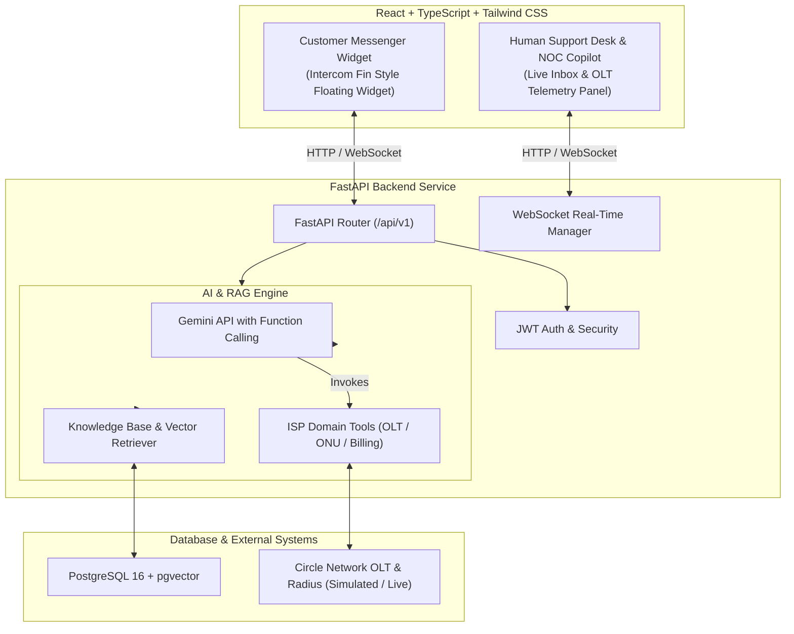

# Circle AI — AI-First ISP Customer Support Platform

> Inspired by **Intercom Fin**, tailored specifically for **Circle Network**, an optical fiber Internet Service Provider (ISP) in Bangladesh.

Circle AI is a modern customer support architecture that automatically resolves repetitive subscriber issues (optical signal loss, red LOS light on ONU, bKash payment verification, package upgrades, Wi-Fi router PPPoE setup) using **Google Gemini with Function Calling**, while providing human NOC and support officers an Intercom-style real-time collaboration inbox.

---

## 🏗️ Architecture Overview



---

## 📂 Repository Structure

```
circle_ai/
├── backend/
│   ├── app/
│   │   ├── api/
│   │   │   ├── v1/
│   │   │   │   ├── auth.py              # JWT authentication & session tokens
│   │   │   │   ├── customers.py         # Subscriber lookup & OLT fiber diagnostics
│   │   │   │   ├── conversations.py     # Conversation threads & message history
│   │   │   │   ├── tickets.py           # Escalated NOC support tickets
│   │   │   │   ├── ai.py                # Gemini chat & tool execution endpoint
│   │   │   │   ├── rag.py               # Knowledge base search & article store
│   │   │   │   ├── analytics.py         # AI deflection & resolution statistics
│   │   │   │   └── websocket.py         # Real-time bidirectional chat WebSocket
│   │   │   └── router.py                # Main API router aggregator
│   │   ├── core/
│   │   │   ├── config.py                # Pydantic BaseSettings & env parser
│   │   │   ├── security.py              # Password hashing & JWT token management
│   │   │   ├── database.py              # SQLAlchemy 2.0 async engine & sessions
│   │   │   └── websocket_manager.py     # Active client connection broadcast manager
│   │   ├── models/
│   │   │   ├── user.py                  # NOC Staff & Support agents
│   │   │   ├── customer.py              # Circle Network subscriber with OLT telemetry
│   │   │   ├── conversation.py          # Conversations and Message history
│   │   │   ├── ticket.py                # Escalated field & NOC support tickets
│   │   │   └── knowledge.py             # ISP FAQ & documentation articles
│   │   ├── schemas/                     # Pydantic request/response models
│   │   ├── services/
│   │   │   ├── ai/
│   │   │   │   └── agent.py             # Gemini API with Function Calling & ISP persona
│   │   │   ├── isp_tools/
│   │   │   │   └── tools.py             # ONU optical diagnosis, billing, port reboot
│   │   │   └── rag/
│   │   │       └── retriever.py         # Hybrid / vector retriever for ISP docs
│   │   └── main.py                      # FastAPI application entrypoint & CORS
│   ├── .env.example                     # Backend environment template
│   ├── requirements.txt                 # Backend Python dependencies
│   └── Dockerfile                       # Backend containerization
├── frontend/
│   ├── src/
│   │   ├── components/
│   │   │   ├── widget/
│   │   │   │   └── MessengerWidget.tsx  # Intercom Fin-style subscriber widget
│   │   │   ├── dashboard/
│   │   │   │   └── HumanSupportDashboard.tsx # Human desk inbox & OLT telemetry
│   │   │   └── common/
│   │   │       └── Navbar.tsx           # Navigation & view toggle
│   │   ├── services/
│   │   │   └── api.ts                   # Unified REST client
│   │   ├── types/
│   │   │   └── index.ts                 # Full TypeScript definitions
│   │   ├── App.tsx                      # Top-level view orchestrator
│   │   ├── main.tsx                     # React DOM entry
│   │   └── index.css                    # Tailwind CSS directives
│   ├── package.json                     # Frontend dependencies & scripts
│   ├── vite.config.ts                   # Vite bundler & reverse proxy
│   ├── tailwind.config.js               # Tailwind CSS theme
│   ├── .env.example                     # Frontend environment variables
│   └── Dockerfile                       # Frontend Nginx production container
├── docker-compose.yml                   # Full-stack orchestration (PostgreSQL + pgvector)
├── .gitignore
└── README.md
```

---

## 🚀 Quickstart & Running Locally

### 1. Backend Setup (FastAPI)

```bash
cd backend

# Option A: Install dependencies in your virtual environment
pip install -r requirements.txt

# Option B: Run with Uvicorn
uvicorn app.main:app --reload --port 8000
```

- API Base URL: `http://localhost:8000`
- Interactive OpenAPI Docs: `http://localhost:8000/docs`
- Health check: `http://localhost:8000/health`

### 2. Frontend Setup (React + Vite)

```bash
cd frontend

# Install dependencies
npm install

# Start development server
npm run dev
```

- Web Application: `http://localhost:5173`
- The Vite dev server automatically proxies `/api` and `/ws` to `http://localhost:8000`.

---

## 📡 ISP Tool Calling Capabilities

The AI Agent automatically recognizes customer intent and triggers specialized ISP functions:

| Tool Name | Purpose | Example Query |
| :--- | :--- | :--- |
| `diagnose_onu_status` | Queries OLT for optical power (dBm), PON port, ONU MAC & status | *"My internet is slow, check my signal"* |
| `check_subscriber_billing` | Fetches plan, due amounts, and bKash merchant payment flow | *"How much is my bill and how do I pay via bKash?"* |
| `reboot_onu_session` | Dispatches soft reboot / session refresh command on OLT | *"Can you reset or reboot my connection port?"* |
| `list_internet_plans` | Lists 20 Mbps to 100 Mbps fiber plans with BDT pricing | *"What packages do you have?"* |
| `escalate_to_human_agent` | Creates an escalated NOC ticket for human support officers | *"I need to speak with a human support agent"* |

---

## 🔐 Environment Variables

### Backend (`backend/.env`)
```ini
PROJECT_NAME="Circle AI"
VERSION="0.1.0"
ENVIRONMENT="development"
DEBUG=true

# Database (Default: SQLite for local dev, PostgreSQL for production)
DATABASE_URL="sqlite+aiosqlite:///./circle_ai.db"

# Google Gemini API
GEMINI_API_KEY="your-gemini-api-key-here"
GEMINI_MODEL="gemini-1.5-flash"

# ISP Settings
ISP_NAME="Circle Network"
ISP_SUPPORT_HOTLINE="09611800800"
ISP_BKASH_MERCHANT_NO="01844XXXXXX"
```

### Frontend (`frontend/.env`)
```ini
VITE_API_URL="http://localhost:8000"
VITE_WS_URL="ws://localhost:8000"
VITE_ISP_NAME="Circle Network"
```
