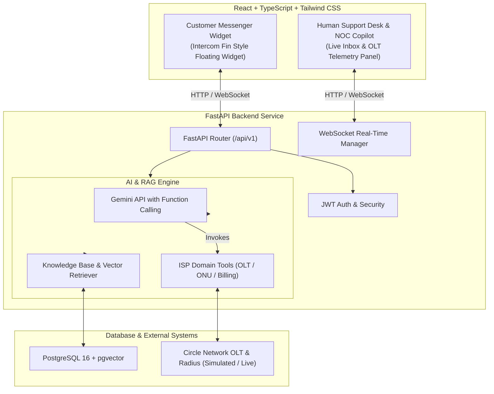

# Circle AI — AI-First ISP Customer Support Platform

> Inspired by **Intercom Fin**, tailored specifically for **Circle Network**, an optical fiber Internet Service Provider (ISP) in Bangladesh.

Circle AI is a modern customer support architecture that automatically resolves repetitive subscriber issues (optical signal loss, red LOS light on ONU, bKash payment verification, package upgrades, Wi-Fi router PPPoE setup) using **Google Gemini with Function Calling**, while providing human NOC and support officers an Intercom-style real-time collaboration inbox.

---

## 🏗️ Architecture Overview



---

## 📂 Repository Structure

```
circle_ai/
├── backend/
│   ├── app/
│   │   ├── api/
│   │   │   ├── v1/
│   │   │   │   ├── auth.py              # JWT authentication & session tokens
│   │   │   │   ├── customers.py         # Subscriber lookup & OLT fiber diagnostics
│   │   │   │   ├── conversations.py     # Conversation threads & message history
│   │   │   │   ├── tickets.py           # Escalated NOC support tickets
│   │   │   │   ├── ai.py                # Gemini chat & tool execution endpoint
│   │   │   │   ├── rag.py               # Knowledge base search & article store
│   │   │   │   ├── analytics.py         # AI deflection & resolution statistics
│   │   │   │   └── websocket.py         # Real-time bidirectional chat WebSocket
│   │   │   └── router.py                # Main API router aggregator
│   │   ├── core/
│   │   │   ├── config.py                # Pydantic BaseSettings & env parser
│   │   │   ├── security.py              # Password hashing & JWT token management
│   │   │   ├── database.py              # SQLAlchemy 2.0 async engine & sessions
│   │   │   └── websocket_manager.py     # Active client connection broadcast manager
│   │   ├── models/
│   │   │   ├── user.py                  # NOC Staff & Support agents
│   │   │   ├── customer.py              # Circle Network subscriber with OLT telemetry
│   │   │   ├── conversation.py          # Conversations and Message history
│   │   │   ├── ticket.py                # Escalated field & NOC support tickets
│   │   │   └── knowledge.py             # ISP FAQ & documentation articles
│   │   ├── schemas/                     # Pydantic request/response models
│   │   ├── services/
│   │   │   ├── ai/
│   │   │   │   └── agent.py             # Gemini API with Function Calling & ISP persona
│   │   │   ├── isp_tools/
│   │   │   │   └── tools.py             # ONU optical diagnosis, billing, port reboot
│   │   │   └── rag/
│   │   │       └── retriever.py         # Hybrid / vector retriever for ISP docs
│   │   └── main.py                      # FastAPI application entrypoint & CORS
│   ├── .env.example                     # Backend environment template
│   ├── requirements.txt                 # Backend Python dependencies
│   └── Dockerfile                       # Backend containerization
├── frontend/
│   ├── src/
│   │   ├── components/
│   │   │   ├── widget/
│   │   │   │   └── MessengerWidget.tsx  # Intercom Fin-style subscriber widget
│   │   │   ├── dashboard/
│   │   │   │   └── HumanSupportDashboard.tsx # Human desk inbox & OLT telemetry
│   │   │   └── common/
│   │   │       └── Navbar.tsx           # Navigation & view toggle
│   │   ├── services/
│   │   │   └── api.ts                   # Unified REST client
│   │   ├── types/
│   │   │   └── index.ts                 # Full TypeScript definitions
│   │   ├── App.tsx                      # Top-level view orchestrator
│   │   ├── main.tsx                     # React DOM entry
│   │   └── index.css                    # Tailwind CSS directives
│   ├── package.json                     # Frontend dependencies & scripts
│   ├── vite.config.ts                   # Vite bundler & reverse proxy
│   ├── tailwind.config.js               # Tailwind CSS theme
│   ├── .env.example                     # Frontend environment variables
│   └── Dockerfile                       # Frontend Nginx production container
├── docker-compose.yml                   # Full-stack orchestration (PostgreSQL + pgvector)
├── .gitignore
└── README.md
```

---

## 🚀 Quickstart & Running Locally

### 1. Backend Setup (FastAPI)

```bash
cd backend

# Option A: Install dependencies in your virtual environment
pip install -r requirements.txt

# Option B: Run with Uvicorn
uvicorn app.main:app --reload --port 8000
```

- API Base URL: `http://localhost:8000`
- Interactive OpenAPI Docs: `http://localhost:8000/docs`
- Health check: `http://localhost:8000/health`

### 2. Frontend Setup (React + Vite)

```bash
cd frontend

# Install dependencies
npm install

# Start development server
npm run dev
```

- Web Application: `http://localhost:5173`
- The Vite dev server automatically proxies `/api` and `/ws` to `http://localhost:8000`.

---

## 📡 ISP Tool Calling Capabilities

The AI Agent automatically recognizes customer intent and triggers specialized ISP backend functions:

| Tool Name | Domain | Purpose | Example Query |
| :--- | :--- | :--- | :--- |
| `get_customer_info` | Customer | Fetches subscriber profile, package & optical telemetry | *"Who am I / check my account CN-88214"* |
| `verify_customer` | Security | Verifies subscriber identity before exposing billing/line data | *"Verify my account with phone 01711000001"* |
| `check_connection_status` | NOC / OLT | Inspects live optical power (dBm), ONU status, & PON port | *"My internet is slow, check my signal"* |
| `check_internet_outage` | Network | Checks area-wide fiber backbone cuts & scheduled maintenance | *"Is there an outage in Dhanmondi?"* |
| `troubleshoot_internet` | Support | Provides step-by-step fiber & Wi-Fi router troubleshooting | *"Wi-Fi router shows orange light / slow speed"* |
| `check_customer_bill` | Billing | Fetches current monthly bill, dues, and billing cycle date | *"How much is my bill and when is the due date?"* |
| `check_payment_status` | Billing | Verifies recent bKash / Nagad / card payment status | *"Did you receive my bKash payment?"* |
| `get_available_packages` | Sales | Returns official Circle Network 2026 fiber packages | *"What packages do you offer?"* |
| `recommend_internet_package` | Sales | Matches optimal package based on usage (gaming/streaming) | *"Recommend a gaming package under ৳2500"* |
| `check_service_coverage` | Sales | Verifies optical coverage in specific zones & districts | *"Do you provide internet in Mirpur or Uttara?"* |
| `create_connection_lead` | Sales | Registers new customer installation inquiries in CRM | *"I want to take a new connection in Banani"* |
| `create_complaint_ticket` | NOC Support | Dispatches official NOC complaint ticket for field tech | *"File a complaint for high optical loss"* |
| `get_ticket_status` | Support | Tracks real-time NOC ticket resolution & assigned agent | *"What is the status of ticket TKT-2026-0042?"* |
| `request_human_support` | Escalation | Seamlessly transfers conversation to live NOC human agent | *"I need to speak with a human support agent"* |

---

## 🔐 Security Architecture & Production Hardening

Circle AI implements enterprise-grade security protocols:

1. **Authentication & Password Hashing**:
   - Passwords hashed using `bcrypt` (12 salt rounds, 72-byte safe truncation).
   - Stateless JWT tokens signed with `HS256` and configurable expiration (`ACCESS_TOKEN_EXPIRE_MINUTES`).

2. **Role-Based Access Control (RBAC)**:
   - Granular role tiers: `admin`, `supervisor`, `agent`, `noc_engineer`, and `customer`.
   - Subscriber PII endpoints (`/api/v1/customers`, `/api/v1/tickets`) strictly require authenticated Agent or Admin tokens.

3. **API Rate Limiting (Sliding Window)**:
   - Enforced by custom ASGI middleware:
     - Auth Login (`/api/v1/auth/login`): **10 req/min** (brute-force defense).
     - AI Chat (`/api/v1/ai/chat`): **30 req/min** (LLM cost & abuse defense).
     - General Endpoints: **120 req/min**.
   - Responds with `HTTP 429 Too Many Requests` and a standard `Retry-After: <seconds>` header.

4. **Input Sanitization & XSS Defense**:
   - Pydantic v2 schemas (`TicketCreate`, `MessageCreate`, `CustomerBase`, `ConversationFeedbackCreate`) strip dangerous HTML tags (`<script>`, `<iframe>`, `<style>`) and control characters before database persistence.

5. **Secure WebSocket Authorization**:
   - WebSocket `/ws/chat/{id}?client_type=agent&token={jwt}` requires valid JWT tokens before admitting agent connections, preventing unauthorized subscriber snooping into private agent internal notes.

6. **Audit Logging & Telemetry**:
   - All tool executions are logged with inputs, outputs, execution latency (ms), confidence score, and subscriber ID in `tool_logs`.

---

## 🐳 Production Deployment Guide

### Option 1: Docker Compose (Full Stack with PostgreSQL + pgvector)

```bash
# 1. Clone repository
git clone https://github.com/circlenetwork/circle-ai.git
cd circle-ai

# 2. Configure environment files
cp backend/.env.example backend/.env
# Edit backend/.env and provide your GEMINI_API_KEY and production SECRET_KEY

# 3. Launch stack with Docker Compose
docker compose up --build -d
```

Services will start:
- **Frontend SPA (Nginx)**: `http://localhost:5173` (or port 80 in production)
- **FastAPI Backend**: `http://localhost:8000`
- **PostgreSQL 16 + pgvector**: `localhost:5432`

### Option 2: Production Nginx Reverse Proxy with HTTPS

```nginx
# /etc/nginx/sites-available/chat.circlenetworkbd.net
server {
    listen 80;
    server_name chat.circlenetworkbd.net;
    return 301 https://$host$request_uri;
}

server {
    listen 443 ssl http2;
    server_name chat.circlenetworkbd.net;

    ssl_certificate /etc/letsencrypt/live/chat.circlenetworkbd.net/fullchain.pem;
    ssl_certificate_key /etc/letsencrypt/live/chat.circlenetworkbd.net/privkey.pem;

    # Frontend Static SPA
    location / {
        root /var/www/circle_ai/frontend/dist;
        index index.html;
        try_files $uri $uri/ /index.html;
    }

    # Backend API Reverse Proxy
    location /api/ {
        proxy_pass http://127.0.0.1:8000;
        proxy_set_header Host $host;
        proxy_set_header X-Real-IP $remote_addr;
        proxy_set_header X-Forwarded-For $proxy_add_x_forwarded_for;
        proxy_set_header X-Forwarded-Proto $scheme;
    }

    # WebSocket Real-Time Chat & Handoff
    location /ws/ {
        proxy_pass http://127.0.0.1:8000;
        proxy_http_version 1.1;
        proxy_set_header Upgrade $http_upgrade;
        proxy_set_header Connection "Upgrade";
        proxy_set_header Host $host;
        proxy_read_timeout 86400s;
        proxy_send_timeout 86400s;
    }
}
```

### Option 3: Embed Messenger on Official Website (`circlenetworkbd.net`)

Paste before the closing `</body>` tag on the main WordPress or custom HTML site:

```html
<!-- Circle AI Customer Messenger Embed -->
<script
  src="https://chat.circlenetworkbd.net/widget.js"
  id="circle-ai-messenger-script"
  data-isp="Circle Network"
  data-primary-color="#FDBC1F"
  data-hotline="16207"
  defer
></script>
<script>
  window.addEventListener('DOMContentLoaded', function() {
    if (window.CircleAIWidget) {
      window.CircleAIWidget.init({
        primaryColor: '#FDBC1F',
        secondaryColor: '#3F3F3F',
        initialLanguage: 'bn',
        defaultOpen: false
      });
    }
  });
</script>
```

---

## 🧪 Automated Testing & Verification

Run the comprehensive production readiness test suite:

```bash
cd backend
python test_production_readiness.py
```

Coverage:
- ✅ Password Hashing (Bcrypt 12 rounds)
- ✅ JWT Token Generation & Verification
- ✅ Role-Based Access Control (RBAC 401/403)
- ✅ Sliding-Window Rate Limiting (429 Too Many Requests)
- ✅ Input Sanitization & XSS Tag Stripping
- ✅ 12 SQLAlchemy 2.0 Database Tables & Seed Data
- ✅ All 14 ISP Domain Tools Execution
- ✅ Gemini Function Calling & Multi-Turn Workflows
- ✅ Bilingual RAG Vector Semantic Search (English & Bangla)


---

## 🔐 Environment Variables

### Backend (`backend/.env`)
```ini
PROJECT_NAME="Circle AI"
VERSION="0.1.0"
ENVIRONMENT="development"
DEBUG=true

# Database (Default: SQLite for local dev, PostgreSQL for production)
DATABASE_URL="sqlite+aiosqlite:///./circle_ai.db"

# Google Gemini API
GEMINI_API_KEY="your-gemini-api-key-here"
GEMINI_MODEL="gemini-1.5-flash"

# ISP Settings
ISP_NAME="Circle Network"
ISP_SUPPORT_HOTLINE="09611800800"
ISP_BKASH_MERCHANT_NO="01844XXXXXX"
```

### Frontend (`frontend/.env`)
```ini
VITE_API_URL="http://localhost:8000"
VITE_WS_URL="ws://localhost:8000"
VITE_ISP_NAME="Circle Network"
```
